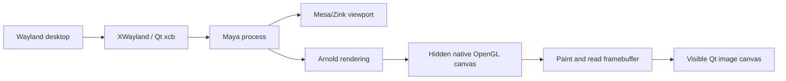

# Maya on Wayland with NVIDIA: Mesa/Zink viewport and Arnold Qt canvas

A documented workaround for Maya 2026 under a Wayland desktop, using **XWayland**, Mesa/Zink for the viewport, and a Qt canvas for Arnold RenderView.

On the tested machine, NVIDIA's native OpenGL path left Maya's viewport black. Switching the process to Mesa/Zink restored the viewport, but Arnold RenderView produced trails and sluggish image navigation. This workaround keeps the working viewport and replaces Arnold's visible image canvas with a `QGraphicsView`.

**Status: experimental, verified interactively on one configuration.** This is a community workaround, not native Wayland support or an Autodesk-supported compatibility patch.

## Release v0.1.0

Full-resolution capture, cursor-centered wheel zoom, native mesh picking and press-held highlighting. No render-resolution, sampling or color-quality reduction is used for optimization. See [changes](CHANGELOG.md) and [performance measurements](docs/performance.md).

## Verified configuration

| Component | Tested version |
| --- | --- |
| OS | Ubuntu 26.04.1 LTS |
| Maya | 2026 |
| MtoA / Arnold | 5.5.0 / 7.4.0.0 |
| Qt | 6.5.3, PySide6 |
| GPU | NVIDIA GeForce RTX 5090 |
| NVIDIA driver | 595.99 |
| Mesa packages | 26.0.8-1ubuntu0.3 |
| XWayland | 24.1.10 |
| OpenGL renderer | Zink over NVIDIA's proprietary Vulkan driver |

Initial validation: October 11, 2026. Pointer-centered wheel zoom and full-frame capture updated October 12, 2026. Other versions and GPUs need testing. See [known limitations](docs/limitations.md) before installing.

## What was confirmed

- Maya's viewport works through Mesa/Zink on the tested system.
- Arnold's image can be displayed without trails in the Qt canvas.
- Image panning, zooming and framing were confirmed by the user.
- Full-resolution 2500 × 1406 pixels were verified in the Qt buffer even with a smaller visible window.
- The original native container stays in its QObject hierarchy, hidden at render resolution plus padding; the Qt canvas occupies its place in the visible splitter. This avoids competing native resize operations.
- Wheel zoom preserves the point under the cursor, including after right-button zoom.
- Left click selects a mesh through Arnold. Native highlighting is copied while the button is held and disappears on release.
- IPR updates continue while navigating the camera in Maya's viewport.
- Redshift's viewer worked in the same Mesa-backed process. Inspection showed a `QGraphicsView`-based image widget, while Arnold used a native `QOpenGLWindow` inside a `QWindowContainer`. This comparison motivated the workaround; it does not prove a defect in a particular driver.

## Launch Maya through XWayland and Mesa

Maya, MtoA, the NVIDIA driver, Mesa/Zink and XWayland must already be installed. This repository does not install applications or change licensing.

First check the renderer, if `glxinfo` is available:

```bash
__GLX_VENDOR_LIBRARY_NAME=mesa glxinfo -B
```

Confirm that the renderer reports **Zink and your GPU**, not `llvmpipe` or `softpipe`. The launcher selects the Mesa GLX vendor; it does not guarantee that every distribution will select Zink automatically.

```bash
bash scripts/launch-maya.sh
```

For a different installation path:

```bash
MAYA_BIN=/usr/autodesk/maya/bin/maya bash scripts/launch-maya.sh
```

The launcher sets only:

```text
QT_QPA_PLATFORM=xcb
__GLX_VENDOR_LIBRARY_NAME=mesa
MAYA_VP2_DEVICE_OVERRIDE=VirtualDeviceGLCore
```

These apply to that launch. It does not edit `Maya.env`, desktop shortcuts, system drivers, or renderer library paths. Keep any renderer-specific environment your existing launcher needs. Changing the GLX vendor affects the Maya process; this fix does not give Arnold a separate NVIDIA OpenGL context.

## Install the Arnold canvas

Close Maya first. Run from the repository directory, without `sudo`:

```bash
python3 scripts/manage.py install --maya-version 2026
```

This copies two Python modules into `~/maya/2026/scripts/` and appends a marked deferred startup hook to `userSetup.py`. Existing modules and startup files are backed up in a uniquely named directory. An existing marked Arnold Qt hook is refused to prevent a duplicate installation.

For a custom user scripts directory:

```bash
python3 scripts/manage.py install --scripts-dir "/path/to/maya/user/scripts"
```

Restart Maya using the Mesa launcher, then open **Arnold → Arnold RenderView**. The watcher installs the canvas once the native window exists. It does not load MtoA or start a render by itself.

The watcher interval is 500 ms. Image refresh is requested every 50 ms during activity or while frames change. After 20 identical frames and no recent interaction, it backs off to 250 ms. Actual refresh speed depends on rendering, framebuffer copying and Maya's UI thread. Copies pause briefly during gestures **inside the viewer**, not during camera navigation in Maya.

### Controls

| Input | Action |
| --- | --- |
| Left click | Native mesh selection; highlight while held |
| Middle-button drag | Pan |
| Alt + left-button drag | Pan |
| Right-button horizontal drag, with or without Alt | Zoom around the starting cursor position |
| Mouse wheel | Zoom around the cursor position |
| F, with focus in the canvas | Frame the displayed image |

Original Arnold rendering controls remain in its toolbar. The adapter enables Arnold's **Scene Updates** option for live IPR. It does not change samples, lights, shaders or the rendering device.

## Upgrade from an earlier managed installation

Close Maya and run `python3 scripts/manage.py uninstall --maya-version 2026` from the earlier checkout. Then install from this release with the same scripts directory. The installer refuses duplicate hooks; it does not overwrite an existing manifest silently. If installed modules were edited, review and back them up before removing them manually. For a hand-installed version, retain your backups and update only the adapter modules and its marked hook.

## Uninstall

Close Maya, then use the same target directory as during installation:

```bash
python3 scripts/manage.py uninstall --maya-version 2026
```

The uninstaller removes its exact startup block, restores any replaced modules and preserves unrelated startup edits. It refuses to discard modules modified after installation. Backups remain available. Restart Maya to restore the original canvas.

For an earlier hand-installed version without an installation manifest, remove only its marked startup block and its two modules manually after making a backup. This installer does not silently adopt that installation.

## How it works



Arnold still renders and draws its native framebuffer. The native canvas is hidden; its `paintEvent()` is invoked with its OpenGL context current, and `grabFramebuffer()` supplies a `QImage`. The hidden original native container has a fixed render-sized surface with 64 pixels of padding on each edge, independently of the visible window. When the configured render resolution changes, native framing is initialized at 1:1 in deferred steps. Only the outer padding is cropped; the render pixels are not downsampled. The visible Qt canvas fits or zooms that full-resolution pixmap.

Exact comparison of consecutive framebuffers avoids repeating the padding crop for identical images. Unchanged pixmaps are not uploaded again, and the scene extent is changed only when image dimensions change. Native click coordinates are reconstructed from the Qt scene position and padding.

The previous current OpenGL context is restored after capture.

The shipped runtime follows the implementation validated in Maya, including some retained setup scaffolding from its development. It uses internal Arnold widget class names and a hidden-window rendering path. See [technical limitations](docs/limitations.md).

## Troubleshooting and contributions

See [troubleshooting](docs/troubleshooting.md) and [read-only diagnostics](docs/diagnostics.md). Report OS, Maya/MtoA/Qt versions, GPU, driver, Mesa renderer and a small reproducible case. Remove personal paths, scene names and license/account data before sharing logs.

Installer tests run without Maya:

```bash
python3 -m unittest discover -s tests -v
bash -n scripts/launch-maya.sh
```

These tests verify installation and rollback. Optional Qt checks validate wheel anchoring, full-resolution crop pixels (including alpha) and identical-frame reuse:

```bash
QT_QPA_PLATFORM=offscreen /usr/autodesk/maya2026/bin/mayapy tests/qt_canvas_checks.py
```

Live graphics compatibility, native picking and highlighting were checked manually in Maya on the configuration above. They are not established by the offscreen tests.

## References and licensing

- [Mesa Zink documentation](https://docs.mesa3d.org/drivers/zink.html): OpenGL implemented over Vulkan.
- [Qt window-container documentation](https://doc.qt.io/qt-6/qwidget.html#createWindowContainer): native-window integration and stacking limitations.
- [Qt QOpenGLWindow](https://doc.qt.io/qt-6/qopenglwindow.html): framebuffer access and context behavior.
- [Autodesk Maya system requirements](https://www.autodesk.com/support/technical/article/caas/sfdcarticles/sfdcarticles/System-requirements-for-Autodesk-Maya.html).
- [Autodesk Linux installation requirements](https://help.autodesk.com/cloudhelp/2026/ENU/Maya-Installlation/files/GUID-D2B5433C-E0D2-421B-9BD8-24FED217FD7F.htm): includes a Wayland limitation for Maya 2026 licensing.

Original scripts and documentation are provided under the [MIT license](LICENSE). Maya, Arnold, NVIDIA and Redshift are third-party products; their binaries and licenses are not included.
